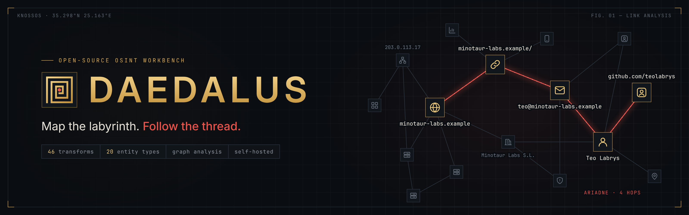
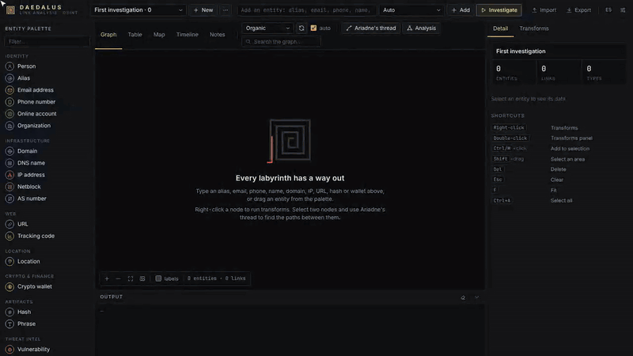
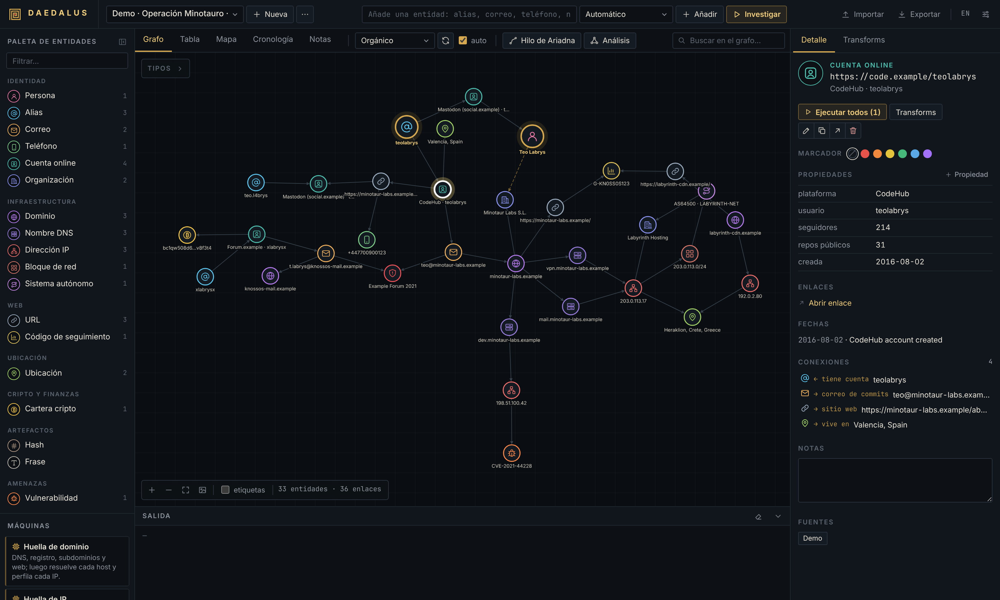
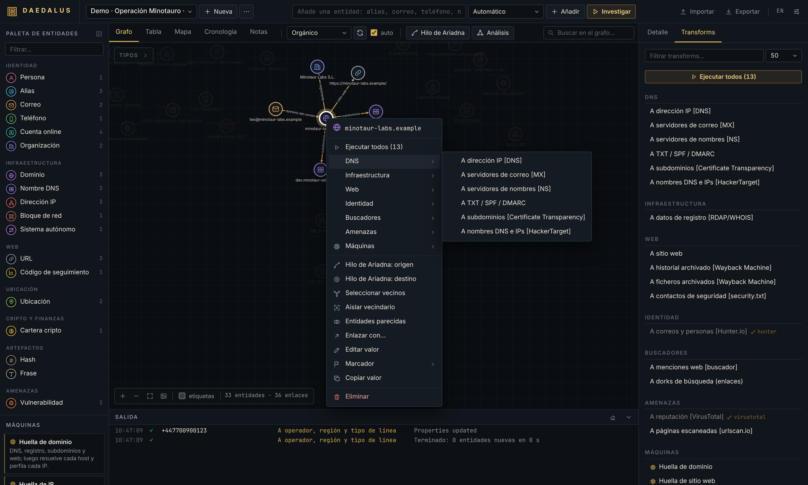
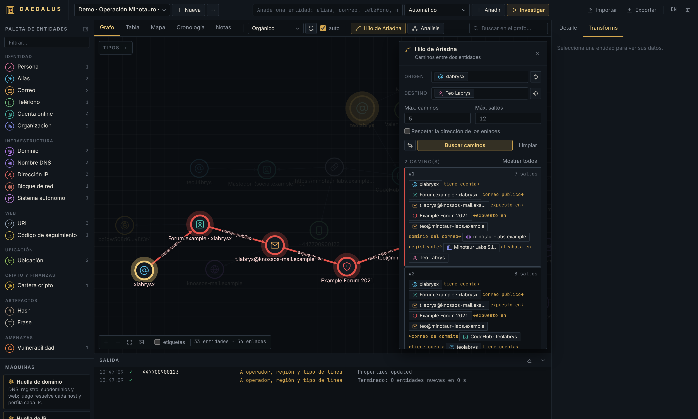
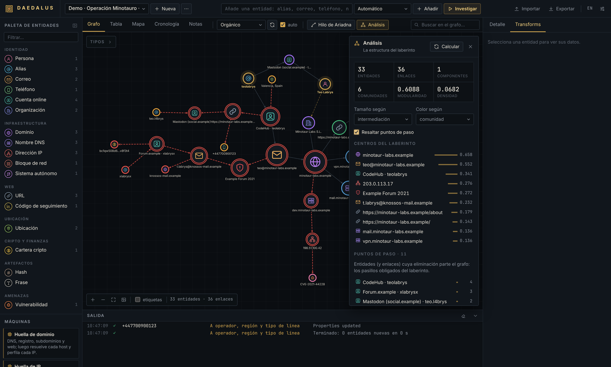
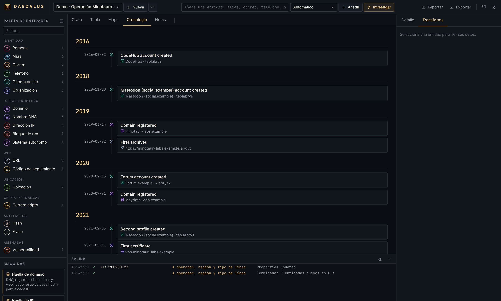

<p align="center">
  
</p>

<p align="center">
  <a href="https://github.com/BreaGG/DAEDALUS/actions/workflows/ci.yml"></a>
  
  
</p>

**DAEDALUS** es un banco de trabajo autoalojado para análisis de vínculos e inteligencia de fuentes abiertas. Partes de
una sola pista (un alias, un correo, un dominio, una IP, una cartera de criptomonedas), la amplías con *transforms* que
consultan fuentes públicas y terminas con un grafo al que puedes hacer preguntas: quién está detrás de esta cuenta, qué
infraestructura se comparte y cuál es la cadena de evidencias más corta entre dos cosas que no deberían tener nada que
ver.

Creado por **Alejandro Brea** · [Read in English](README.md)

<p align="center">
  <a href="docs/img/demo.mp4"></a><br>
  <sub>Recorrido de 30 segundos · <a href="docs/img/demo.mp4">ver en Full HD (MP4)</a></sub>
</p>

---

- [La idea](#la-idea)
- [Un recorrido en cinco pasos](#un-recorrido-en-cinco-pasos)
- [Ponerlo en marcha](#ponerlo-en-marcha)
- [Documentación](#documentación)
- [Fuentes](#fuentes)
- [Ampliarlo](#ampliarlo)
- [Por dentro](#por-dentro)
- [Ética](#ética)
- [Contribuir](#contribuir)
- [Licencia](#licencia)

## La idea

En el mito, Dédalo diseñó el laberinto de Cnosos y el hilo de Ariadna devolvió a Teseo a la salida. Una investigación
se vive igual desde dentro: cada pivote abre pasillos nuevos y, al cabo de una hora, cuesta explicar cómo se llegó de la
primera pista a la última. DAEDALUS guarda el mapa del laberinto por ti (el grafo) y te da el hilo (la búsqueda de
caminos) para ver exactamente cómo se conectan dos puntos cualesquiera.

Habla el vocabulario que los analistas ya conocen de Maltego, *entidades*, *transforms* y *máquinas*, y añade lo que un
grafo sabe hacer: caminos más cortos, comunidades, centralidad y puntos de paso. Todo funciona en tu propio equipo o
servidor, en un único proceso de Python con un fichero SQLite, y la mayoría de transforms no necesitan ninguna clave API.

## Un recorrido en cinco pasos

Las capturas son de la investigación de demostración incluida en `examples/operation-minotaur.json`, un caso inventado
en el que todas las personas, dominios `.example` e IPs de rangos de documentación son ficticios. Impórtala para seguir
el recorrido sin conexión.

**1. Suelta una pista.** Escribe cualquier cosa en la barra superior (DAEDALUS reconoce 20 tipos de entidad: alias,
correos, teléfonos, nombres, dominios, IPs, bloques de red, URLs, carteras, hashes, CVEs, códigos de seguimiento,
coordenadas…) o arrastra un tipo desde la paleta. Las fotos que sueltes en el lienzo se leen para extraer EXIF y GPS.



**2. Amplíala.** Haz clic derecho sobre una entidad para lanzar uno de sus transforms, todos a la vez o una *máquina*
que avanza varios pasos sola (huellas de dominio, IP, identidad y sitio web, o el *Laberinto* sin final fijo). Los
resultados llegan en directo y cada nodo nuevo conserva un enlace con etiqueta que explica de dónde salió.



**3. Sigue el hilo.** Elige un origen y un destino y Ariadna devuelve los *k* caminos más cortos entre ellos, salto a
salto, con la evidencia de cada enlace. Con tres o más entidades seleccionadas dibuja el subgrafo mínimo que las une.



**4. Lee la estructura.** El panel de análisis dimensiona los nodos por intermediación, PageRank o grado, los colorea
por comunidad, marca los puntos de paso cuya eliminación partiría el caso y sugiere entidades del mismo tipo que
comparten vecinos y podrían ser la misma identidad.



**5. Sitúalo en el tiempo y el espacio, y redacta el informe.** Cada dato fechado aparece en una cronología y cada
coordenada en un mapa. Notas, marcadores, una tabla ordenable y la exportación a JSON, GraphML (Gephi, yEd), CSV y PNG
cierran el ciclo.



## Ponerlo en marcha

| Dónde | Cómo |
|---|---|
| **Tu ordenador** (Python 3.11+) | `git clone https://github.com/BreaGG/DAEDALUS.git && cd DAEDALUS && ./start.sh` (Windows: `start.bat`). Abre `http://127.0.0.1:8787`. |
| **Docker** | `DAEDALUS_PASSWORD='cadena-larga-y-aleatoria' docker compose up -d --build` |
| **Railway** | Despliega el repositorio (incluye un `railway.toml`), añade la variable `DAEDALUS_PASSWORD`, monta un volumen y genera un dominio. |
| **Tu propio servidor** | Docker Compose detrás de Caddy o Nginx con HTTPS. |

DAEDALUS no tiene cuentas de usuario: cualquiera que llegue a él puede usarlo. Por defecto sólo escucha en `127.0.0.1`;
siempre que lo expongas, define `DAEDALUS_PASSWORD` y sírvelo por HTTPS (en Railway no arranca sin contraseña). Las
instrucciones completas, las variables de entorno y un ejemplo de proxy inverso están en el
[capítulo de despliegue](docs/es/documentacion-tecnica.md#4-despliegue).

La interfaz está en inglés por defecto y también en español (*Settings → Language*).

## Documentación

- [**Guía de usuario**](docs/es/guia-de-usuario.md): cada panel, flujo de trabajo y ajuste, con investigaciones de
  ejemplo y solución de problemas.
- [**Documentación técnica**](docs/es/documentacion-tecnica.md): arquitectura, configuración, despliegue, modelo de
  seguridad, la API HTTP con eventos de progreso en directo y cómo escribir transforms, máquinas y plugins.
- [**Referencia**](docs/es/transforms.md): todos los tipos de entidad, los 46 transforms, las máquinas y las claves API,
  generada a partir del código.

También en inglés: [user guide](docs/en/user-guide.md), [technical documentation](docs/en/technical.md),
[reference](docs/en/transforms.md).

## Fuentes

46 transforms agrupados en nueve familias; 41 de ellos no necesitan ninguna clave.

- **DNS e infraestructura**: A/AAAA, MX, NS, TXT con análisis de SPF y DMARC, DNS inverso, subdominios por
  transparencia de certificados, nombres alojados en la misma IP, RDAP y WHOIS, titularidad y enrutamiento de IPs
  (RIPEstat), geolocalización, puertos abiertos y CVEs conocidos (Shodan InternetDB).
- **Web**: descubrimiento del sitio, extracción de correos, teléfonos, perfiles sociales, identificadores de analítica y
  dominios enlazados, historial y ficheros archivados de la Wayback Machine, `security.txt`.
- **Identidad y redes**: análisis de correos y teléfonos, barrido de alias en más de 75 sitios (400+ con la lista
  opcional de Sherlock) que verifica cada acierto, perfiles detallados en diez plataformas, GitHub con correos de
  commits, Gravatar, permutaciones de nombres.
- **Búsqueda, ubicación y blockchain**: menciones web (DuckDuckGo, Google con Serper o Brave), Wikidata, dorks
  preparados, geocodificación con OpenStreetMap, saldo, actividad y contrapartes de carteras Bitcoin y Ethereum.
- **Inteligencia de amenazas**: filtraciones (XposedOrNot, Have I Been Pwned), CIRCL hashlookup, NVD y, con clave,
  VirusTotal, Shodan, AbuseIPDB y urlscan.io.

## Ampliarlo

Un transform es una pequeña clase asíncrona de Python. Guárdala en la carpeta `plugins/` de tu carpeta de datos,
reinicia y aparecerá en el menú contextual de los tipos de entidad que acepte:

```python
from daedalus.transforms import L, Transform, register


@register
class EmailHashes(Transform):
    name = "plugin_email_hashes"
    title = L("To MD5 / SHA-256 hashes", "A hashes MD5 / SHA-256")
    description = L("Hashes of the address, as used by Gravatar and leak dumps.", "Hashes de la dirección.")
    inputs = ("email",)

    async def run(self, ctx):
        import hashlib
        email = ctx.value.lower().encode()
        ctx.add("hash", hashlib.md5(email).hexdigest(), {"algorithm": "MD5"}, label="MD5")
        ctx.add("hash", hashlib.sha256(email).hexdigest(), {"algorithm": "SHA-256"}, label="SHA-256")
```

La [documentación técnica](docs/es/documentacion-tecnica.md#10-ampliar-daedalus) describe la API completa de
`Context`, las máquinas, los plugins y cómo probar transforms con HTTP simulado. Todo lo que hace la interfaz está
disponible también mediante una API JSON, así que DAEDALUS se puede automatizar.

## Por dentro

- **Backend**: Python, FastAPI y httpx; un motor de trabajos asíncrono que transmite el progreso con Server-Sent
  Events; almacenamiento en SQLite; algoritmos de grafos (Yen, Brandes, PageRank, Louvain, Tarjan) escritos sin
  dependencias externas.
- **Frontend**: módulos ES sin frameworks, con Cytoscape.js y Leaflet incluidos en el repositorio. Sin compilación;
  funciona sin conexión salvo las teselas del mapa.
- **Calidad**: tests de pytest con todo el HTTP simulado, ruff e integración continua en Python 3.11 a 3.13.

```bash
pip install -e ".[dev]" && pytest -q && ruff check daedalus tests
python scripts/gen_docs.py   # regenera la referencia tras cambiar transforms
```

## Ética

DAEDALUS sólo recoge lo que devuelven las fuentes públicas y los servicios que tú configuras, pero las técnicas que
automatiza pueden hacer daño si se usan mal. Úsalo para investigación de seguridad, inteligencia de amenazas,
periodismo, diligencia debida o para auditar tu propia exposición. No lo uses para vigilar, acosar o perfilar a
personas sin base legal, y respeta la normativa de protección de datos y los términos de cada fuente que consultes.

## Contribuir

Se agradecen los avisos de errores, transforms nuevos, traducciones y correcciones. Lee
[CONTRIBUTING.md](CONTRIBUTING.md) antes de abrir una pull request.

## Licencia

Copyright © 2026 Alejandro Brea. DAEDALUS es software libre: puedes redistribuirlo y/o modificarlo bajo
los términos de la [GNU General Public License](LICENSE) publicada por la Free Software Foundation, ya sea la versión 3
de la licencia o (a tu elección) cualquier versión posterior (GPL-3.0-or-later). Se distribuye con la esperanza de que
sea útil, pero SIN NINGUNA GARANTÍA; consulta la licencia para más detalles.

Las librerías de terceros incluidas mantienen sus propias licencias, recogidas en
[THIRD_PARTY_NOTICES.md](THIRD_PARTY_NOTICES.md).
