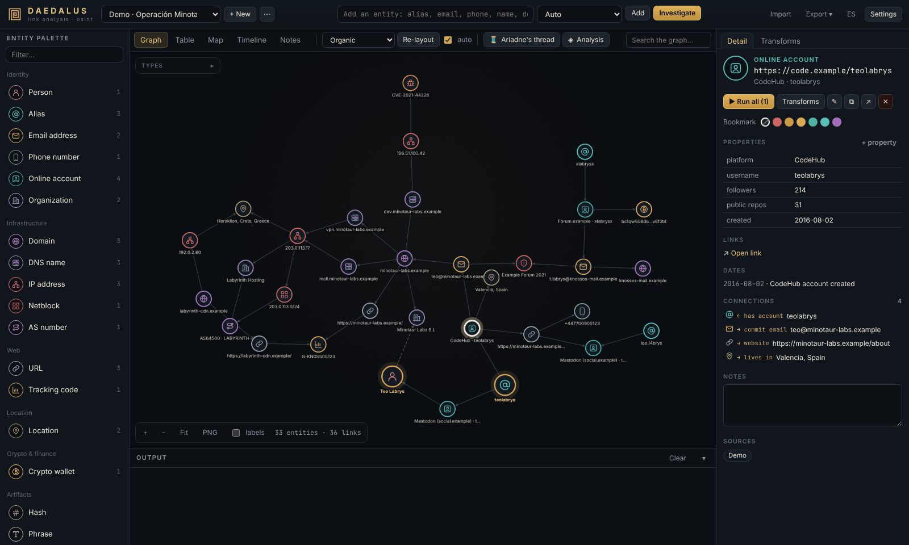
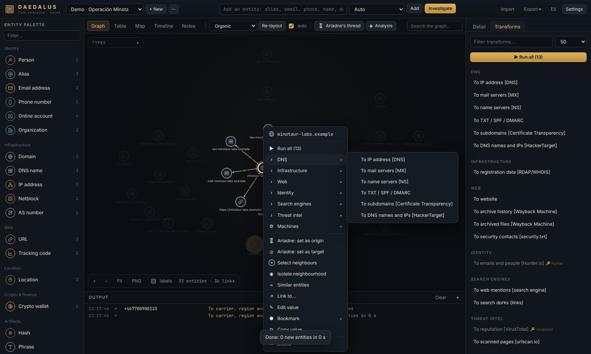
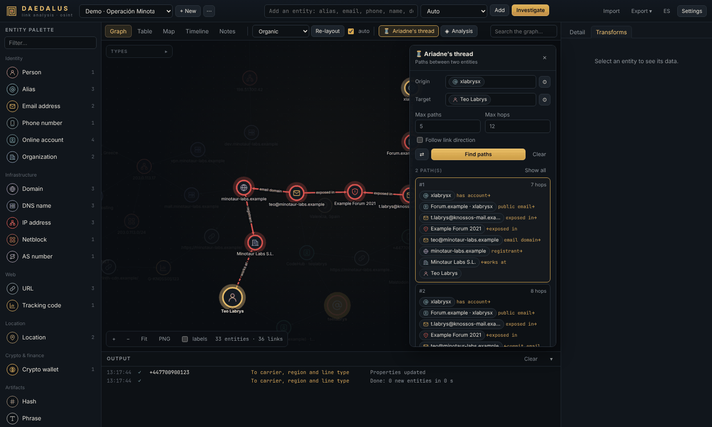
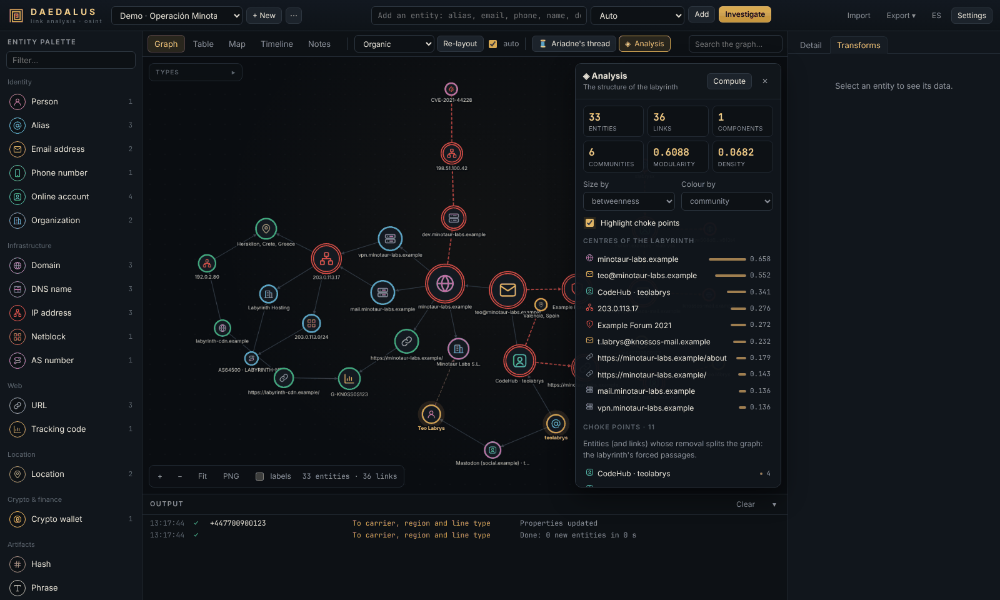
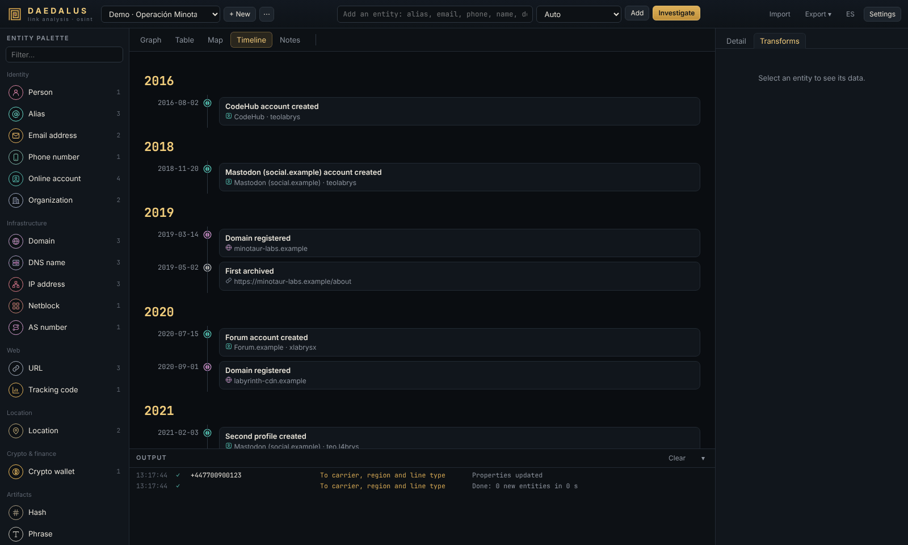

<p align="center">
  
</p>

<p align="center">
  <a href="https://github.com/BreaGG/DAEDALUS/actions/workflows/ci.yml"></a>
  
  
</p>

**DAEDALUS** is a self-hosted workbench for link analysis and open-source intelligence. You start from a single clue
(an alias, an email address, a domain, an IP, a crypto wallet), expand it with *transforms* that query public sources,
and end up with a graph you can question: who is behind this account, which infrastructure is shared, and what is the
shortest chain of evidence between two things that should have nothing in common.

Created by **Alejandro Brea** · [Leer en español](README.es.md)

---

- [The idea](#the-idea)
- [A tour in five steps](#a-tour-in-five-steps)
- [Run it](#run-it)
- [Documentation](#documentation)
- [Sources](#sources)
- [Extending](#extending)
- [Under the hood](#under-the-hood)
- [Ethics](#ethics)
- [License](#license)

## The idea

In the myth, Daedalus designed the labyrinth of Knossos and Ariadne's thread led Theseus back out of it. An
investigation feels the same from the inside: every pivot opens new corridors, and after an hour it is hard to say how
you got from the first clue to the last one. DAEDALUS keeps the map of the labyrinth for you (the graph) and gives you
the thread (path finding) to see exactly how any two points are connected.

It speaks the vocabulary analysts already know from Maltego, *entities*, *transforms* and *machines*, and adds what a
graph is good for: shortest paths, communities, centrality and choke points. Everything runs on your own machine or
server, in a single Python process with a SQLite file, and most transforms work without any API key.

## A tour in five steps

The screenshots come from the demo investigation bundled in `examples/operation-minotaur.json`, a made-up case where
every person, `.example` domain and documentation-range IP is fictional. Import it to follow along offline.

**1. Drop a clue.** Type anything in the top bar (DAEDALUS recognises 20 entity types: aliases, emails, phones, names,
domains, IPs, netblocks, URLs, wallets, hashes, CVEs, tracking codes, coordinates…) or drag a type from the palette.
Photos dropped on the canvas are read for EXIF data and GPS.



**2. Expand it.** Right-click an entity to run one of its transforms, run them all, or launch a *machine* that walks
several steps on its own (domain, IP, identity and website footprints, or the open-ended *Labyrinth*). Results stream
in live and every new node keeps a labelled link explaining where it came from.



**3. Follow the thread.** Pick an origin and a target and Ariadne returns the *k* shortest paths between them, hop by
hop, with the evidence on every link. With three or more entities selected it draws the smallest subgraph that joins
them.



**4. Read the structure.** The analysis panel sizes nodes by betweenness, PageRank or degree, colours them by
community, marks the choke points whose removal would split the case, and suggests same-type entities that share
neighbours and may be the same identity.



**5. Put it in time and space, then report.** Every dated fact lands on a timeline, every coordinate on a map. Notes,
bookmarks, a sortable table and exports to JSON, GraphML (Gephi, yEd), CSV and PNG close the loop.



## Run it

| Where | How |
|---|---|
| **Your computer** (Python 3.11+) | `git clone https://github.com/BreaGG/DAEDALUS.git && cd DAEDALUS && ./start.sh` (Windows: `start.bat`). Opens `http://127.0.0.1:8787`. |
| **Docker** | `DAEDALUS_PASSWORD='long-random-string' docker compose up -d --build` |
| **Railway** | Deploy the repository (it ships a `railway.toml`), add the `DAEDALUS_PASSWORD` variable, attach a volume, generate a domain. |
| **Your own server** | Docker Compose behind Caddy or Nginx with HTTPS. |

DAEDALUS has no user accounts: anyone who can reach it can use it. It only listens on `127.0.0.1` by default; whenever
you expose it, set `DAEDALUS_PASSWORD` and serve it over HTTPS (on Railway it refuses to start without a password).
Full instructions, environment variables and a reverse-proxy example are in the
[deployment chapter](docs/en/technical.md#4-deployment).

The interface is in English by default and also available in Spanish (*Settings → Language*).

## Documentation

- [**User guide**](docs/en/user-guide.md): every panel, workflow and setting, with example investigations and
  troubleshooting.
- [**Technical documentation**](docs/en/technical.md): architecture, configuration, deployment, security model, the
  HTTP API with live progress events, and how to write transforms, machines and plugins.
- [**Reference**](docs/en/transforms.md): all entity types, the 46 transforms, the machines and the API keys,
  generated from the code.

Also in Spanish: [guía de usuario](docs/es/guia-de-usuario.md),
[documentación técnica](docs/es/documentacion-tecnica.md), [referencia](docs/es/transforms.md).

## Sources

46 transforms grouped in nine families; 41 of them need no key at all.

- **DNS and infrastructure**: A/AAAA, MX, NS, TXT with SPF and DMARC parsing, reverse DNS, subdomains from certificate
  transparency, co-hosted names, RDAP and WHOIS, IP ownership and routing (RIPEstat), geolocation, open ports and known
  CVEs (Shodan InternetDB).
- **Web**: website discovery, page scraping for emails, phones, social profiles, analytics IDs and outbound domains,
  Wayback Machine history and archived files, `security.txt`.
- **Identity and social**: email and phone analysis, an alias sweep over 75+ sites (400+ with the optional Sherlock
  list) that double-checks every hit, detailed profiles on ten platforms, GitHub with commit emails, Gravatar, name
  permutations.
- **Search, location and blockchain**: web mentions (DuckDuckGo, Google via Serper or Brave), Wikidata, ready-made
  dorks, OpenStreetMap geocoding, Bitcoin and Ethereum balances, activity and counterparties.
- **Threat intelligence**: breaches (XposedOrNot, Have I Been Pwned), CIRCL hashlookup, NVD, and with a key VirusTotal,
  Shodan, AbuseIPDB and urlscan.io.

## Extending

A transform is a small async Python class. Save it in the `plugins/` folder of your data directory, restart, and it
appears in the right-click menu of the entity types it accepts:

```python
from daedalus.transforms import L, Transform, register


@register
class EmailHashes(Transform):
    name = "plugin_email_hashes"
    title = L("To MD5 / SHA-256 hashes", "A hashes MD5 / SHA-256")
    description = L("Hashes of the address, as used by Gravatar and leak dumps.", "Hashes de la dirección.")
    inputs = ("email",)

    async def run(self, ctx):
        import hashlib
        email = ctx.value.lower().encode()
        ctx.add("hash", hashlib.md5(email).hexdigest(), {"algorithm": "MD5"}, label="MD5")
        ctx.add("hash", hashlib.sha256(email).hexdigest(), {"algorithm": "SHA-256"}, label="SHA-256")
```

The [technical documentation](docs/en/technical.md#10-extending-daedalus) describes the full `Context` API, machines,
plugins and how to test transforms against mocked HTTP. Everything the interface does is also available through a
JSON API, so DAEDALUS can be scripted.

## Under the hood

- **Backend**: Python, FastAPI and httpx; an asyncio job engine that streams progress over Server-Sent Events;
  SQLite storage; graph algorithms (Yen, Brandes, PageRank, Louvain, Tarjan) written without external dependencies.
- **Frontend**: plain ES modules with Cytoscape.js and Leaflet bundled in the repository. No build step, works
  offline except for map tiles.
- **Quality**: a pytest suite where every HTTP call is mocked, ruff, and CI on Python 3.11 to 3.13.

```bash
pip install -e ".[dev]" && pytest -q && ruff check daedalus tests
python scripts/gen_docs.py   # regenerate the reference after changing transforms
```

## Ethics

DAEDALUS only collects what public sources and the services you configure return, but the techniques it automates can
hurt people when misused. Use it for security research, threat intelligence, journalism, due diligence or to audit your
own exposure. Do not use it to stalk, harass or profile individuals without a lawful basis, and respect
data-protection law and the terms of every source you query.

## License

MIT © 2026 Alejandro Brea. Bundled third-party libraries keep their own licences, listed in
[THIRD_PARTY_NOTICES.md](THIRD_PARTY_NOTICES.md).
