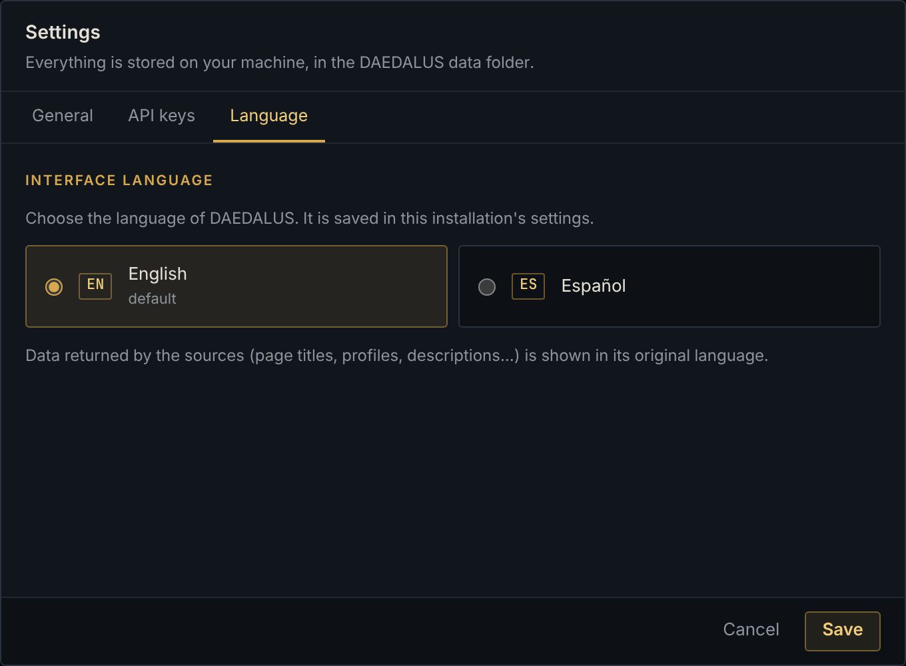

# DAEDALUS user guide

Author: **Alejandro Brea**

DAEDALUS turns scattered clues (an alias, an email, a domain, a wallet…) into a graph you can explore, expand
and reason about. This guide covers everything you can do from the web interface. For installation, configuration,
the REST API and extending DAEDALUS, see the [technical documentation](technical.md).

**Contents**

1. [Key concepts](#1-key-concepts)
2. [First steps](#2-first-steps)
3. [The workspace](#3-the-workspace)
4. [Adding and editing entities](#4-adding-and-editing-entities)
5. [Running transforms](#5-running-transforms)
6. [Machines](#6-machines)
7. [Navigating the graph](#7-navigating-the-graph)
8. [Ariadne's thread: finding paths](#8-ariadnes-thread-finding-paths)
9. [Structural analysis](#9-structural-analysis)
10. [Table, map, timeline and notes](#10-table-map-timeline-and-notes)
11. [Cleaning up: merge and delete](#11-cleaning-up-merge-and-delete)
12. [Investigations, import and export](#12-investigations-import-and-export)
13. [Settings](#13-settings)
14. [Keyboard and mouse reference](#14-keyboard-and-mouse-reference)
15. [Example workflows](#15-example-workflows)
16. [Troubleshooting and FAQ](#16-troubleshooting-and-faq)
17. [Responsible use and OPSEC](#17-responsible-use-and-opsec)

---

## 1. Key concepts

| Concept | What it is |
|---|---|
| **Investigation** | A case: one graph with its entities, links, notes and layout. You can keep as many as you like and switch between them from the top bar. |
| **Entity** | A node of the graph: a person, alias, email, phone, domain, IP, URL, wallet, hash, location… There are 20 types (see the [reference](transforms.md#entities)). Each entity has a value, properties, notes and an optional bookmark. |
| **Seed** | An entity you added yourself. Seeds are drawn larger with a gold ring. |
| **Link** | A labelled, directed relationship between two entities (`teolabrys —has account→ GitHub · teolabrys`). Transforms create links; you can also draw them by hand (shown dashed). |
| **Property** | A fact attached to an entity (registrar, open ports, followers, balance…). Shown in the inspector. |
| **Transform** | An action that takes one entity and discovers related entities or properties, usually by querying a public source. There are 46 built in. |
| **Machine** | A scripted chain of transforms that walks outwards from your seeds over several stages. |
| **Ariadne's thread** | The path finder: it shows every route that connects two entities through the graph. |

## 2. First steps

1. **Start DAEDALUS** (`./start.sh`, `start.bat`, `daedalus` or Docker, see the [technical docs](technical.md#3-running-and-configuration))
   and open `http://127.0.0.1:8787`. If the instance is protected, your browser asks for credentials: any user
   name and the configured password.
2. **Choose your language** in **Settings → Language**. English is the default; Spanish is also available. The
   **EN/ES** button in the top bar switches between them too. The choice is saved with the installation.
3. **Create an investigation** with **+ New** (a first one is created automatically).
4. **Want a guided tour?** Click **Import** and pick `examples/operation-minotaur.json` from the repository: a small
   fictional case (every person, `.example` domain and documentation-range IP in it is made up) that you can use
   to try every feature without querying anything.

## 3. The workspace

| Area | Where | What for |
|---|---|---|
| **Top bar** | top | Investigation selector, **+ New**, **⋯** (rename / delete), the quick-add bar, **Import**, **Export**, language switch and **Settings**. |
| **Entity palette** | left | Every entity type you can create (with how many the case has), the list of **machines** and the **image** drop zone. The button next to its title folds it into a rail of type icons (still clickable and draggable); on windows narrower than 1100 px it starts folded. |
| **Toolbar** | above the canvas | View tabs (**Graph, Table, Map, Timeline, Notes**), layout selector, **Re-layout**, **auto** layout, **Ariadne's thread**, **Analysis** and the graph search box. |
| **Canvas** | centre | The graph. The **Types** box (top left) lists the entity types present and lets you hide them; the bottom-left bar has zoom, **Fit**, **PNG**, link **labels** and counters. |
| **Inspector** | right | **Detail** of the selected entity (properties, links, dates, connections, notes, history) and the **Transforms** panel. |
| **Output** | bottom | Live log of every transform run with its status, plus a progress bar and **Cancel** while jobs are running. |

## 4. Adding and editing entities

### Quick add

Type anything in the top bar and press **Enter** (or **Add**). DAEDALUS recognises the type automatically and shows
it in the selector (`Auto · IP address`); pick another type in the selector if the guess is wrong.
**Investigate** adds the entity *and* runs every default transform on it in one go.

Recognised automatically: URLs, emails, IPv4/IPv6, CIDR netblocks, `AS…` numbers, `CVE-…` identifiers, analytics
tracking codes (`UA-`, `G-`, `GTM-`, `ca-pub-`), `lat, lon` coordinates, Bitcoin/Ethereum/Litecoin/Dogecoin/Tron/Monero
addresses, MD5/SHA hashes, phone numbers, domains and DNS names, names written as `Name Surname`, aliases and,
as a last resort, free-text phrases. The full list with examples is in the [reference](transforms.md#entities).

### Other ways to add

- **Palette**: click a type to open the *New entity* dialog, or **drag** it onto the canvas to create it exactly where
  you drop it.
- **Canvas right-click → Add entity here**: choose the type from the menu.
- **Photos**: drop an image on the canvas or on the palette's *Image (EXIF/GPS)* zone. DAEDALUS extracts camera,
  dates, author and GPS position, and creates the image plus its SHA-256 **hash**, the **location** where it was
  taken and the **people** named in its metadata (author, owner, copyright).

### Editing

Select an entity to see it in the inspector:

- **✎ Edit value** renames it. If another entity of the same type already has that value, both are merged.
- **+ property** adds a custom property; hover a property and click **✕** to remove it.
- **Notes** are saved automatically as you type.
- **Bookmark**: six colours that draw a ring around the node, useful to tag "confirmed", "to review", "suspect"…
- **↗ Link to…** (also in the right-click menu) starts link mode: click the target entity and give the link a label.
  Right-click a link to rename or delete it.
- **⧉** copies the value; **✕** deletes the entity.

## 5. Running transforms

### Where to run them

- **Right-click an entity** (or a selection): the menu groups the transforms that apply by category
  (DNS, Infrastructure, Web, Identity, Social, Search, Location, Blockchain, Threat intel) plus **Run all** and
  **Machines**.
- **Transforms panel** (inspector, or double-click a node): the same list with a description and the result of the last
  run of each transform on that entity. Use the filter box to find one quickly.
- **Run all** runs every transform marked *default* (a few noisy ones, such as name permutations, archived files or
  wallet counterparties, only run when you pick them explicitly).

Running on a **selection** applies each transform to every selected entity it accepts.

### What happens

Results stream in live. New entities appear around the entity that produced them, linked with a label that explains
the relationship. Entities that already existed are reused and their properties merged, so the graph never
duplicates the same email or domain. When the job ends, the graph re-layouts itself if **auto** is ticked.

Each run is logged in **Output** and in the entity's **Transforms run** history:

| Status | Meaning |
|---|---|
| ✓ ok | Found something (the number shows how many results). |
| ∅ empty | The source answered but had nothing. |
| ⏭ skipped | Could not run: missing API key, rate limit, unsupported input… The message says why. |
| ✕ error | Network error, timeout or unexpected answer. |

### Result limit

The **Limit** selector of the Transforms panel (12 / 50 / 255 / 1000) caps how many entities a single run may add,
like Maltego's slider. When a run hits it, the message says *limit reached*. The value you pick there lasts until
you reload the page; the permanent default is in **Settings → General**.

### Keys and locked transforms

Transforms that need an API key show **🔑** with the key's name and are dimmed until you add it; clicking one opens
**Settings → API keys**. Most transforms (41 of 46) need no key at all.

### Sites that blocked the check

The account sweep double-checks every hit against a random alias to throw away sites that say "yes" to everything.
Sites that blocked the automatic check (captcha, WAF, rate limit) are listed under **To check by hand** in the
alias's detail, with a link to open each profile yourself.

### Cancelling

**Cancel** in the Output bar stops every running job of the current investigation. What was already found stays.

## 6. Machines

Machines chain transforms over several **stages**: stage 1 runs on the seeds, and each following stage only on what
the previous one produced. Launch them from the right-click menu, from the Transforms panel or from the palette (with
entities selected).

| Machine | Use it on | What it does |
|---|---|---|
| **Domain footprint** | domain | DNS, registration, subdomains, website, security.txt and archive; then resolves every host and profiles each IP. |
| **IP footprint** | IP, netblock | Owner, network, location, exposed services and names hosted on the IP. |
| **Identity footprint** | alias, email, phone, person | Accounts, profiles, breaches and new aliases, two levels deep. |
| **Website footprint** | URL, domain, DNS name | Contacts, profiles and trackers on the site, then one step into the linked domains. |
| **Labyrinth** | anything | Runs every default transform and keeps walking outwards for 1-3 levels (choose in the Transforms panel). |

Every machine stops expanding when it reaches **Settings → General → Max entities per machine** (60 by default), so
an auto-expansion cannot run away. The exact stages are in the [reference](transforms.md#machines).

## 7. Navigating the graph

- **Select**: click a node; **Ctrl/⌘ + click** adds to the selection; **Shift + drag** draws a selection box;
  **Ctrl+A** selects everything visible.
- **Hover** a node to highlight its neighbourhood and show the labels of its links.
- **Layouts** (toolbar): *Organic* (force-directed, the default), *Hierarchical* (top-down tree), *Radial* (around
  the seeds), *Circular*, *Concentric* (most connected in the centre) and *Blocks by type*. **Re-layout** recomputes
  it from scratch. Untick **auto** if you prefer to keep your manual arrangement after each transform. Node
  positions are saved with the investigation.
- **Search the graph** (toolbar): highlights matching nodes; **Enter** jumps from one match to the next.
- **Types** box: click a type to hide or show it (handy to remove noise such as URLs or breaches).
- **Right-click → Select neighbours** expands the selection one hop; **Isolate neighbourhood** dims everything except
  the selection and its direct neighbours; **Similar entities** highlights entities that share many neighbours with
  the selected one.
- **labels** (bottom bar) shows every link label permanently. **Fit** (or **F**) frames the whole graph;
  **Esc** clears selection and highlights.

## 8. Ariadne's thread: finding paths

Ariadne answers *"how is A connected to B?"*.

1. Right-click the first entity → **Ariadne: set as origin**, then the second → **Ariadne: set as target**
   (or open **Ariadne's thread** in the toolbar, select a node and press **⊙** next to Origin / Target).
2. The search runs as soon as both ends are set. Adjust **Max paths** (1-25), **Max hops** (1-30) and
   **Follow link direction**, then press **Find paths** again.
3. Results are ordered from shortest to longest. Each card shows the chain of entities and the label of every hop;
   an arrow pointing left (`←exposed in`) means that hop goes against the link's direction. Click a card to highlight
   that path on the canvas, or **Show all** to see every path at once. **⇄** swaps origin and target.

**Connect selected**: select three or more entities and press **Connect selected** (or right-click → *Connect
selected*) to highlight the smallest set of entities and links that joins all of them. Unreachable pairs are
reported.

> Tip: hubs that everybody shares (a big breach, a hosting provider) create short but meaningless paths. Hide their
> type in the **Types** box, delete them, or raise *Max paths* to look beyond them. Free webmail domains (gmail.com,
> outlook.com…) are never added as entities precisely to avoid false bridges.

## 9. Structural analysis

Open **Analysis** in the toolbar and press **Compute**. It works on the whole investigation:

| Measure | What it tells you |
|---|---|
| **Components** | Separate islands of the graph. More than one means some clues are not connected yet. |
| **Communities** (and **modularity**) | Groups of entities more connected to each other than to the rest (Louvain algorithm). Modularity above ~0.3 means the groups are clear. Often one community = one identity or one infrastructure. |
| **Density** | How many of the possible links exist (0-1). |
| **Degree** | Number of links of an entity. |
| **Betweenness** | How often an entity lies on the shortest paths between others: the bridges of the labyrinth. |
| **PageRank** | Importance by being linked from important entities. |
| **Choke points** | Entities (and links) whose removal splits the graph in two: the forced passages between parts of the case. |
| **Same identity?** | Pairs of entities of the same type that share two or more neighbours without being linked: candidates for being the same person or asset. **Merge** joins them. |

Use **Size by** (degree, betweenness, PageRank) and **Colour by** (type, community, component) to paint the graph,
and **Highlight choke points** to draw them with a double red ring (bridges as dashed red links). **Centres of the
labyrinth** lists the entities with the highest betweenness. Click any row to select it. When the graph changes, a
notice reminds you to compute again.

## 10. Table, map, timeline and notes

- **Table**: every entity with type, links, sources and date added. Filter by text (it searches values, properties and
  notes) or by type, sort by any column, tick rows and **Delete checked**. Clicking a row selects the entity.
- **Map**: entities with coordinates (IP geolocation, geocoded locations, photo GPS). Click a marker to see its
  connections and jump back to the graph. Map tiles are loaded from OpenStreetMap/CARTO.
- **Timeline**: every dated fact found by transforms (domain registered, account created, breach, first archive,
  certificate, last wallet activity, photo taken…), grouped by year. Click an event to go to its entity.
- **Notes**: free text for the whole investigation, saved automatically.

## 11. Cleaning up: merge and delete

- **Merge**: select two or more entities of the same type and choose **Merge into one** (right-click or inspector).
  The seed (or the first selected) is kept; properties and notes are combined and every link is moved to it.
- **Delete**: **Del**/**Backspace**, the inspector's **✕**, the right-click menu or the table. Deleting an entity
  removes its links too. Deleting more than one asks for confirmation.
- **Hide instead of delete**: use the **Types** box when you just want less noise.

## 12. Investigations, import and export

- **⋯** next to the selector renames or deletes the current investigation (deleting cannot be undone).
- **Export ▾**:
  - **JSON (DAEDALUS)**: the full investigation, including notes and node positions. Re-import it with **Import**
    (it creates a new investigation named *… (imported)*). This is also the way to back up or share a case.
  - **GraphML**: open the graph in Gephi, yEd or Cytoscape desktop.
  - **Entities CSV** / **Links CSV**: for spreadsheets or other tools.
  - **PNG image**: the whole graph at high resolution (also from the **PNG** button).

## 13. Settings

### General

| Option | Default | Meaning |
|---|---|---|
| Max results per transform | 50 | Default result limit (the Transforms panel can change it until you reload). |
| Max entities per machine | 60 | How many entities a machine may expand before stopping. |
| Per-site timeout in the alias sweep | 12 s | Wait per site when checking an alias. |
| Default country for phones | empty | ISO code (`ES`, `MX`, `US`…) used to read phone numbers written without `+prefix`. |
| Extend the alias sweep with the Sherlock database | off | Adds 400+ sites from the Sherlock project (slower, noisier). |
| Include adult sites in the sweep | off | Only applies with the Sherlock database. |
| Block private addresses in web transforms | on | Web transforms refuse to fetch internal addresses (127.0.0.1, 10.x, 192.168.x…). Keep it on when DAEDALUS is reachable by others. |
| Load remote images automatically | off | Avatars and screenshots are only downloaded when you click **Load image** (they would reveal your IP to the site). Stored in this browser. |

### API keys

Optional keys for Shodan, VirusTotal, Hunter.io, Have I Been Pwned, AbuseIPDB, urlscan.io, GitHub, Serper and Brave
Search, each with a link to get one. Leave a field empty to keep the current key. See which transforms use each key
in the [reference](transforms.md#api-keys).

### Language

English (default) or Español. Saved with the installation, so it is the same in every browser.

## 14. Keyboard and mouse reference

| Action | How |
|---|---|
| Transforms, machines, Ariadne, bookmark, delete… | right-click a node (or selection) |
| Rename / delete a link | right-click the link |
| Add entity at a point, select all, re-layout | right-click the empty canvas |
| Open the Transforms panel | double-click a node |
| Add to selection · box selection | **Ctrl/⌘ + click** · **Shift + drag** |
| Select all | **Ctrl/⌘ + A** |
| Delete selection | **Del** / **Backspace** |
| Clear selection, highlights, menus, link mode | **Esc** |
| Fit the graph | **F** |
| Next search match | **Enter** in the search box |
| Add entity · add and investigate | **Enter** in the quick-add bar · **Investigate** |

## 15. Example workflows

**From an alias to a person.** Add the alias and press **Investigate** (or run the *Identity footprint* machine).
Review the accounts found; open the ones under *To check by hand*. Detailed profiles and GitHub often add a real
name, location, website and commit emails; run the email transforms on those (Gravatar, breaches, domain). Use
*Analysis → Same identity?* to spot aliases that share an email or location, and **Merge** what you confirm.
Bookmark confirmed accounts green and discarded ones red.

**Map an organisation's infrastructure.** Add the domain and run *Domain footprint*. Then *Analysis → Colour by
community* separates mail, web and VPN infrastructure; *Highlight choke points* shows the hosts everything depends
on. Run *IP footprint* on interesting IPs and *To scanned pages [urlscan.io]* for historical pages. Export to
GraphML for a report.

**Prove that two identities are connected.** Put both in the same investigation, expand each one, and set them as
Ariadne's origin and target. Read the hops of the shortest path: each label is the evidence (e.g. *same tracking
code*, *exposed in the same breach*, *commit email*). Open each entity's links and dates to document it.

## 16. Troubleshooting and FAQ

**A transform says *skipped*.** Read the message: a missing API key, a rate limit (GitHub without token allows 60
requests/hour; add a token), or an input it cannot handle.

**Web search returns nothing or asks for a captcha.** DuckDuckGo blocks automated searches from some IPs. Add a
Serper or Brave key in Settings for reliable search.

**Few accounts found / many *To check by hand*.** Social networks block data-centre IPs much more than home
connections. On a hosted instance this is expected; open the listed links yourself.

**The map is grey.** Map tiles come from the internet (OpenStreetMap/CARTO); check the browser's connection.

**Why isn't `gmail.com` added when I expand an email?** Free webmail providers would link every unrelated person who
uses them. DAEDALUS records the provider as a property instead.

**Where is my data?** In the DAEDALUS data folder (`./data` when running from source, the volume on Docker/Railway):
`daedalus.db` holds every investigation and `settings.json` the settings and API keys. Back it up or use
**Export → JSON** per investigation.

**Can several people use one instance?** Yes, with one shared password, but there are no user accounts or
permissions: everyone sees and edits every investigation.

## 17. Responsible use and OPSEC

- DAEDALUS only queries public sources and services you configure, but those services see the requests: they come
  from your IP (or your server's). Use a VPN or a hosted instance if that matters for your investigation.
- Remote images are not loaded unless you ask, for the same reason.
- Use it for legitimate work: security research, threat intelligence, journalism, due diligence or auditing your own
  footprint. Do not use it to stalk, harass or profile people without a lawful basis, and respect data-protection law
  (GDPR and others) and each source's terms of service.
