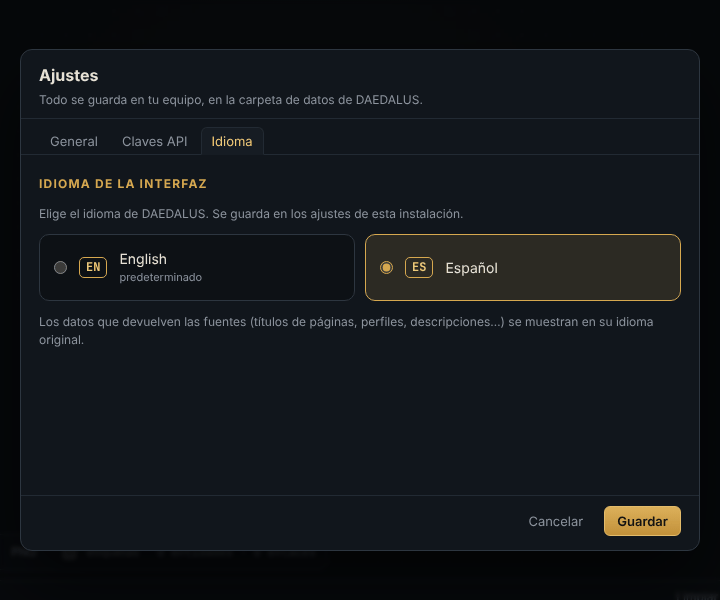

# Guía de usuario de DAEDALUS

Autor: **Alejandro Brea**

DAEDALUS convierte pistas sueltas (un alias, un correo, un dominio, una cartera…) en un grafo que puedes explorar,
ampliar y analizar. Esta guía cubre todo lo que se puede hacer desde la interfaz web. Para la instalación, la
configuración, la API REST y cómo ampliar DAEDALUS, consulta la [documentación técnica](documentacion-tecnica.md).

> La interfaz está en inglés por defecto. Cámbiala a español en **Settings → Language** (o con el botón **ES** de la
> barra superior). Esta guía usa los nombres de la interfaz en español.

**Contenido**

1. [Conceptos clave](#1-conceptos-clave)
2. [Primeros pasos](#2-primeros-pasos)
3. [El espacio de trabajo](#3-el-espacio-de-trabajo)
4. [Añadir y editar entidades](#4-añadir-y-editar-entidades)
5. [Lanzar transforms](#5-lanzar-transforms)
6. [Máquinas](#6-máquinas)
7. [Moverse por el grafo](#7-moverse-por-el-grafo)
8. [El Hilo de Ariadna: encontrar caminos](#8-el-hilo-de-ariadna-encontrar-caminos)
9. [Análisis estructural](#9-análisis-estructural)
10. [Tabla, mapa, cronología y notas](#10-tabla-mapa-cronología-y-notas)
11. [Limpieza: fusionar y eliminar](#11-limpieza-fusionar-y-eliminar)
12. [Investigaciones, importar y exportar](#12-investigaciones-importar-y-exportar)
13. [Ajustes](#13-ajustes)
14. [Referencia de teclado y ratón](#14-referencia-de-teclado-y-ratón)
15. [Flujos de trabajo de ejemplo](#15-flujos-de-trabajo-de-ejemplo)
16. [Problemas frecuentes y preguntas](#16-problemas-frecuentes-y-preguntas)
17. [Uso responsable y OPSEC](#17-uso-responsable-y-opsec)

---

## 1. Conceptos clave

| Concepto | Qué es |
|---|---|
| **Investigación** | Un caso: un grafo con sus entidades, enlaces, notas y disposición. Puedes tener tantas como quieras y cambiar entre ellas desde la barra superior. |
| **Entidad** | Un nodo del grafo: persona, alias, correo, teléfono, dominio, IP, URL, cartera, hash, ubicación… Hay 20 tipos (ver la [referencia](transforms.md#entidades)). Cada entidad tiene un valor, propiedades, notas y un marcador opcional. |
| **Semilla** | Una entidad que añadiste tú. Se dibuja más grande y con un anillo dorado. |
| **Enlace** | Una relación dirigida y con etiqueta entre dos entidades (`teolabrys —tiene cuenta→ GitHub · teolabrys`). Los crean los transforms; también puedes dibujarlos a mano (se ven discontinuos). |
| **Propiedad** | Un dato asociado a una entidad (registrador, puertos abiertos, seguidores, saldo…). Se ve en el inspector. |
| **Transform** | Una acción que toma una entidad y descubre entidades o propiedades relacionadas, normalmente consultando una fuente pública. Hay 46 incluidos. |
| **Máquina** | Una cadena de transforms que avanza desde tus semillas a lo largo de varias etapas. |
| **Hilo de Ariadna** | El buscador de caminos: muestra todas las rutas que conectan dos entidades a través del grafo. |

## 2. Primeros pasos

1. **Arranca DAEDALUS** (`./start.sh`, `start.bat`, `daedalus` o Docker; ver la
   [documentación técnica](documentacion-tecnica.md#3-ejecución-y-configuración)) y abre `http://127.0.0.1:8787`.
   Si la instancia está protegida, el navegador te pedirá credenciales: cualquier usuario y la contraseña configurada.
2. **Elige el idioma** en **Ajustes → Idioma** (*Settings → Language*). El inglés es el predeterminado; también está el
   español. El botón **EN/ES** de la barra superior cambia entre ambos. La elección se guarda en la instalación.
3. **Crea una investigación** con **+ Nueva** (la primera se crea sola).
4. **¿Quieres un recorrido guiado?** Pulsa **Importar** y elige `examples/operation-minotaur.json` del repositorio: un
   caso pequeño y ficticio (todas las personas, dominios `.example` e IPs de rangos de documentación son inventados)
   para probar todas las funciones sin consultar nada.

## 3. El espacio de trabajo

| Zona | Dónde | Para qué |
|---|---|---|
| **Barra superior** | arriba | Selector de investigación, **+ Nueva**, **⋯** (renombrar / eliminar), la barra de alta rápida, **Importar**, **Exportar**, cambio de idioma y **Ajustes**. |
| **Paleta de entidades** | izquierda | Todos los tipos que puedes crear (con cuántos tiene el caso), la lista de **máquinas** y la zona para **imágenes**. El botón junto a su título la pliega en una columna de iconos (que se pueden seguir pulsando y arrastrando); en ventanas de menos de 1100 px empieza plegada. |
| **Barra de herramientas** | sobre el lienzo | Pestañas (**Grafo, Tabla, Mapa, Cronología, Notas**), selector de disposición, **Reorganizar**, **auto**, **Hilo de Ariadna**, **Análisis** y el buscador del grafo. |
| **Lienzo** | centro | El grafo. El cuadro **Tipos** (arriba a la izquierda) lista los tipos presentes y permite ocultarlos; la barra inferior tiene zoom, **Encuadrar**, **PNG**, **etiquetas** de los enlaces y contadores. |
| **Inspector** | derecha | **Detalle** de la entidad seleccionada (propiedades, enlaces, fechas, conexiones, notas, historial) y el panel **Transforms**. |
| **Salida** | abajo | Registro en directo de cada transform con su estado, y una barra de progreso y **Cancelar** mientras hay trabajos en marcha. |

## 4. Añadir y editar entidades

### Alta rápida

Escribe cualquier cosa en la barra superior y pulsa **Intro** (o **Añadir**). DAEDALUS reconoce el tipo solo y lo
muestra en el selector (`Automático · Dirección IP`); si se equivoca, elige otro tipo en el selector.
**Investigar** añade la entidad *y* lanza sobre ella todos los transforms por defecto de una vez.

Se reconocen solos: URLs, correos, IPv4/IPv6, bloques CIDR, números `AS…`, identificadores `CVE-…`, códigos de
seguimiento de analítica (`UA-`, `G-`, `GTM-`, `ca-pub-`), coordenadas `lat, lon`, direcciones de Bitcoin, Ethereum,
Litecoin, Dogecoin, Tron y Monero, hashes MD5/SHA, teléfonos, dominios y nombres DNS, nombres escritos como
`Nombre Apellido`, alias y, como último recurso, frases de texto libre. La lista completa con ejemplos está en la
[referencia](transforms.md#entidades).

### Otras formas de añadir

- **Paleta**: haz clic en un tipo para abrir el diálogo *Nueva entidad*, o **arrástralo** al lienzo para crearla
  justo donde la sueltes.
- **Clic derecho en el lienzo → Añadir entidad aquí**: elige el tipo en el menú.
- **Fotos**: suelta una imagen en el lienzo o en la zona *Imagen (EXIF/GPS)* de la paleta. DAEDALUS extrae cámara,
  fechas, autor y posición GPS, y crea la imagen junto a su **hash** SHA-256, la **ubicación** donde se tomó y las
  **personas** que aparecen en sus metadatos (autor, propietario, copyright).

### Editar

Selecciona una entidad para verla en el inspector:

- **✎ Editar valor** la renombra. Si ya existe otra entidad del mismo tipo con ese valor, se fusionan.
- **+ propiedad** añade una propiedad propia; pasa el ratón por una propiedad y pulsa **✕** para quitarla.
- Las **Notas** se guardan solas mientras escribes.
- **Marcador**: seis colores que dibujan un anillo alrededor del nodo, útiles para marcar «confirmado», «revisar»,
  «sospechoso»…
- **↗ Enlazar con…** (también en el menú contextual) activa el modo enlace: haz clic en la entidad de destino y
  ponle una etiqueta al enlace. Clic derecho sobre un enlace para cambiarle la etiqueta o eliminarlo.
- **⧉** copia el valor; **✕** elimina la entidad.

## 5. Lanzar transforms

### Dónde se lanzan

- **Clic derecho sobre una entidad** (o una selección): el menú agrupa por categorías los transforms que se pueden
  aplicar (DNS, Infraestructura, Web, Identidad, Redes y cuentas, Buscadores, Ubicación, Blockchain, Amenazas), además
  de **Ejecutar todos** y **Máquinas**.
- **Panel Transforms** (en el inspector, o con doble clic sobre un nodo): la misma lista con descripción y el resultado
  de la última ejecución de cada transform sobre esa entidad. Usa el filtro para encontrarlo rápido.
- **Ejecutar todos** lanza los transforms marcados *por defecto* (algunos ruidosos, como las permutaciones de nombre,
  los ficheros archivados o las carteras contraparte, sólo se ejecutan si los eliges a mano).

Si lanzas sobre una **selección**, cada transform se aplica a todas las entidades seleccionadas que acepte.

### Qué pasa

Los resultados llegan en directo. Las entidades nuevas aparecen alrededor de la que las produjo, unidas por un enlace
cuya etiqueta explica la relación. Las entidades que ya existían se reutilizan y se fusionan sus propiedades, así que
el grafo nunca duplica el mismo correo o dominio. Al terminar el trabajo, el grafo se reorganiza si **auto** está
marcado.

Cada ejecución queda en **Salida** y en el historial **Transforms ejecutados** de la entidad:

| Estado | Significado |
|---|---|
| ✓ ok | Encontró algo (el número indica cuántos resultados). |
| ∅ vacío | La fuente respondió pero no tenía nada. |
| ⏭ omitido | No se pudo ejecutar: falta una clave API, límite de peticiones, entrada no soportada… El mensaje explica el motivo. |
| ✕ error | Error de red, tiempo agotado o respuesta inesperada. |

### Límite de resultados

El selector **Límite** del panel Transforms (12 / 50 / 255 / 1000) acota cuántas entidades puede añadir una sola
ejecución, como el deslizador de Maltego. Cuando se alcanza, el mensaje dice *limit reached*. El valor que elijas ahí
dura hasta que recargues la página; el valor predeterminado permanente está en **Ajustes → General**.

### Claves y transforms bloqueados

Los transforms que necesitan una clave API muestran **🔑** con el nombre de la clave y aparecen atenuados hasta que la añades; al pulsar
uno se abre **Ajustes → Claves API**. La mayoría (41 de 46) no necesitan ninguna clave.

### Sitios que bloquearon la comprobación

El barrido de cuentas contrasta cada acierto con un alias aleatorio para descartar los sitios que dicen «sí» a todo.
Los sitios que bloquearon la comprobación automática (captcha, WAF, límite de peticiones) aparecen en **Por comprobar
a mano** dentro del detalle del alias, con un enlace para abrir cada perfil tú mismo.

### Cancelar

**Cancelar** en la barra de Salida detiene todos los trabajos en marcha de la investigación actual. Lo que ya se
encontró se queda.

## 6. Máquinas

Las máquinas encadenan transforms en varias **etapas**: la etapa 1 se ejecuta sobre las semillas y cada etapa
siguiente sólo sobre lo que produjo la anterior. Se lanzan desde el menú contextual, desde el panel Transforms o desde
la paleta (con entidades seleccionadas).

| Máquina | Sobre | Qué hace |
|---|---|---|
| **Huella de dominio** | dominio | DNS, registro, subdominios, web, security.txt y archivo; después resuelve cada host y perfila cada IP. |
| **Huella de IP** | IP, bloque de red | Titular, red, ubicación, servicios expuestos y nombres alojados en la IP. |
| **Huella de identidad** | alias, correo, teléfono, persona | Cuentas, perfiles, filtraciones y nuevos alias, a dos niveles. |
| **Huella de sitio web** | URL, dominio, nombre DNS | Contactos, perfiles y rastreadores de la web, y un paso más en los dominios enlazados. |
| **Laberinto** | cualquiera | Ejecuta todos los transforms por defecto y sigue avanzando 1-3 niveles (se elige en el panel Transforms). |

Toda máquina deja de expandirse al llegar a **Ajustes → General → Máximo de entidades por máquina** (60 por defecto),
así que una expansión automática no se descontrola. Las etapas exactas están en la [referencia](transforms.md#máquinas).

## 7. Moverse por el grafo

- **Seleccionar**: clic en un nodo; **Ctrl/⌘ + clic** suma a la selección; **Shift + arrastrar** dibuja un área de
  selección; **Ctrl+A** selecciona todo lo visible.
- **Pasa el ratón** por un nodo para resaltar su vecindario y ver las etiquetas de sus enlaces.
- **Disposiciones** (barra de herramientas): *Orgánico* (por fuerzas, la predeterminada), *Jerárquico* (árbol de arriba
  abajo), *Radial* (alrededor de las semillas), *Circular*, *Concéntrico* (lo más conectado en el centro) y *Bloques por
  tipo*. **Reorganizar** la recalcula desde cero. Desmarca **auto** si prefieres conservar tu colocación manual tras
  cada transform. Las posiciones de los nodos se guardan con la investigación.
- **Buscar en el grafo**: resalta los nodos que coinciden; **Intro** salta de una coincidencia a la siguiente.
- Cuadro **Tipos**: haz clic en un tipo para ocultarlo o mostrarlo (útil para quitar ruido, como URLs o filtraciones).
- **Clic derecho → Seleccionar vecinos** amplía la selección un salto; **Aislar vecindario** atenúa todo salvo la
  selección y sus vecinos directos; **Entidades parecidas** resalta las que comparten muchos vecinos con la
  seleccionada.
- **etiquetas** (barra inferior) muestra siempre las etiquetas de los enlaces. **Encuadrar** (o **F**) encaja todo el
  grafo; **Esc** limpia la selección y los resaltados.

## 8. El Hilo de Ariadna: encontrar caminos

Ariadna responde a *«¿cómo está conectado A con B?»*.

1. Clic derecho sobre la primera entidad → **Hilo de Ariadna: origen**, y sobre la segunda → **Hilo de Ariadna:
   destino** (o abre **Hilo de Ariadna** en la barra de herramientas, selecciona un nodo y pulsa **⊙** junto a Origen /
   Destino).
2. La búsqueda se lanza en cuanto están los dos extremos. Ajusta **Máx. caminos** (1-25), **Máx. saltos** (1-30) y
   **Respetar la dirección de los enlaces**, y vuelve a pulsar **Buscar caminos**.
3. Los resultados van del más corto al más largo. Cada tarjeta muestra la cadena de entidades y la etiqueta de cada
   salto; una flecha hacia la izquierda (`←expuesto en`) indica que ese salto va en contra de la dirección del enlace.
   Haz clic en una tarjeta para resaltar ese camino en el lienzo, o en **Mostrar todos** para verlos todos a la vez.
   **⇄** intercambia origen y destino.

**Conectar seleccionados**: selecciona tres o más entidades y pulsa **Conectar seleccionados** (o clic derecho →
*Conectar seleccionados*) para resaltar el conjunto mínimo de entidades y enlaces que las une a todas. Se avisa de los
pares que no tienen conexión.

> Consejo: los nodos que comparte todo el mundo (una filtración enorme, un proveedor de hosting) generan caminos cortos
> pero sin sentido. Oculta su tipo en el cuadro **Tipos**, elimínalos o sube *Máx. caminos* para ver más allá. Los
> dominios de correo gratuito (gmail.com, outlook.com…) nunca se añaden como entidades precisamente para evitar
> puentes falsos.

## 9. Análisis estructural

Abre **Análisis** en la barra de herramientas y pulsa **Calcular**. Trabaja sobre toda la investigación:

| Medida | Qué te dice |
|---|---|
| **Componentes** | Islas separadas del grafo. Más de una significa que hay pistas todavía sin conectar. |
| **Comunidades** (y **modularidad**) | Grupos de entidades más conectadas entre sí que con el resto (algoritmo de Louvain). Una modularidad por encima de ~0,3 indica grupos claros. A menudo una comunidad = una identidad o una infraestructura. |
| **Densidad** | Qué proporción de los enlaces posibles existe (0-1). |
| **Grado** | Número de enlaces de una entidad. |
| **Intermediación** | Con qué frecuencia una entidad está en los caminos más cortos entre otras: los puentes del laberinto. |
| **PageRank** | Importancia por estar enlazada desde entidades importantes. |
| **Puntos de paso** | Entidades (y enlaces) cuya eliminación parte el grafo en dos: los pasillos obligados entre partes del caso. |
| **¿La misma identidad?** | Parejas de entidades del mismo tipo que comparten dos o más vecinos sin estar enlazadas: candidatas a ser la misma persona o el mismo activo. **Fusionar** las une. |

Usa **Tamaño según** (grado, intermediación, PageRank) y **Color según** (tipo, comunidad, componente) para pintar
el grafo, y **Resaltar puntos de paso** para dibujarlos con un doble anillo rojo (y los puentes como enlaces rojos
discontinuos). **Centros del laberinto** lista las entidades con más intermediación. Haz clic en cualquier fila para
seleccionarla. Cuando el grafo cambia, un aviso te recuerda volver a calcular.

## 10. Tabla, mapa, cronología y notas

- **Tabla**: todas las entidades con tipo, enlaces, fuentes y fecha de alta. Filtra por texto (busca en valores,
  propiedades y notas) o por tipo, ordena por cualquier columna, marca filas y pulsa **Eliminar marcadas**. Al hacer
  clic en una fila se selecciona la entidad.
- **Mapa**: entidades con coordenadas (geolocalización de IPs, ubicaciones geocodificadas, GPS de fotos). Haz clic en
  un marcador para ver sus conexiones y volver al grafo. Las teselas del mapa vienen de OpenStreetMap/CARTO.
- **Cronología**: cada dato fechado que encuentran los transforms (dominio registrado, cuenta creada, filtración,
  primera captura archivada, certificado, última actividad de una cartera, foto tomada…), agrupado por años. Haz clic
  en un evento para ir a su entidad.
- **Notas**: texto libre de toda la investigación, guardado automáticamente.

## 11. Limpieza: fusionar y eliminar

- **Fusionar**: selecciona dos o más entidades del mismo tipo y elige **Fusionar en una** (clic derecho o inspector).
  Se conserva la semilla (o la primera seleccionada); las propiedades y notas se combinan y todos los enlaces pasan a
  ella.
- **Eliminar**: **Supr**/**Retroceso**, el **✕** del inspector, el menú contextual o la tabla. Eliminar una entidad
  elimina también sus enlaces. Si eliminas más de una, se pide confirmación.
- **Ocultar en vez de eliminar**: usa el cuadro **Tipos** cuando sólo quieras menos ruido.

## 12. Investigaciones, importar y exportar

- **⋯** junto al selector renombra o elimina la investigación actual (eliminarla no se puede deshacer).
- **Exportar ▾**:
  - **JSON (DAEDALUS)**: la investigación completa, con notas y posiciones de los nodos. Se vuelve a cargar con
    **Importar** (crea una investigación nueva llamada *… (imported)*). También es la forma de hacer copia o compartir
    un caso.
  - **GraphML**: abre el grafo en Gephi, yEd o Cytoscape de escritorio.
  - **CSV de entidades** / **CSV de enlaces**: para hojas de cálculo u otras herramientas.
  - **Imagen PNG**: todo el grafo en alta resolución (también desde el botón **PNG**).

## 13. Ajustes

### General

| Opción | Por defecto | Significado |
|---|---|---|
| Resultados máximos por transform | 50 | Límite de resultados predeterminado (el panel Transforms puede cambiarlo hasta que recargues). |
| Máximo de entidades por máquina | 60 | Cuántas entidades puede expandir una máquina antes de detenerse. |
| Tiempo por sitio en el barrido de alias | 12 s | Espera por sitio al comprobar un alias. |
| País por defecto para teléfonos | vacío | Código ISO (`ES`, `MX`, `US`…) para interpretar números escritos sin `+prefijo`. |
| Ampliar el barrido de alias con la base de datos de Sherlock | no | Añade más de 400 sitios del proyecto Sherlock (más lento y con más ruido). |
| Incluir sitios para adultos en el barrido | no | Sólo aplica con la base de Sherlock. |
| Bloquear direcciones privadas en los transforms web | sí | Los transforms web se niegan a acceder a direcciones internas (127.0.0.1, 10.x, 192.168.x…). Déjalo activado si otras personas pueden acceder a DAEDALUS. |
| Cargar imágenes remotas automáticamente | no | Los avatares y capturas sólo se descargan al pulsar **Cargar imagen** (revelarían tu IP al sitio). Se guarda en este navegador. |

### Claves API

Claves opcionales de Shodan, VirusTotal, Hunter.io, Have I Been Pwned, AbuseIPDB, urlscan.io, GitHub, Serper y Brave
Search, cada una con un enlace para conseguirla. Deja un campo vacío para conservar la clave actual. Qué transforms
usan cada clave está en la [referencia](transforms.md#claves-api).

### Idioma

English (predeterminado) o Español. Se guarda en la instalación, así que es el mismo en todos los navegadores.

## 14. Referencia de teclado y ratón

| Acción | Cómo |
|---|---|
| Transforms, máquinas, Ariadna, marcador, eliminar… | clic derecho sobre un nodo (o una selección) |
| Cambiar la etiqueta / eliminar un enlace | clic derecho sobre el enlace |
| Añadir una entidad en un punto, seleccionar todo, reorganizar | clic derecho en el lienzo vacío |
| Abrir el panel Transforms | doble clic sobre un nodo |
| Sumar a la selección · selección por área | **Ctrl/⌘ + clic** · **Shift + arrastrar** |
| Seleccionar todo | **Ctrl/⌘ + A** |
| Eliminar la selección | **Supr** / **Retroceso** |
| Limpiar selección, resaltados, menús y modo enlace | **Esc** |
| Encuadrar el grafo | **F** |
| Siguiente coincidencia de la búsqueda | **Intro** en el buscador |
| Añadir entidad · añadir e investigar | **Intro** en la barra de alta rápida · **Investigar** |

## 15. Flujos de trabajo de ejemplo

**De un alias a una persona.** Añade el alias y pulsa **Investigar** (o lanza la máquina *Huella de identidad*). Revisa
las cuentas encontradas y abre las de *Por comprobar a mano*. Los perfiles detallados y GitHub suelen aportar un nombre
real, una ubicación, una web y correos de commits; lanza sobre esos correos sus transforms (Gravatar, filtraciones,
dominio). Usa *Análisis → ¿La misma identidad?* para detectar alias que comparten correo o ubicación y **Fusiona** lo
que confirmes. Marca en verde las cuentas confirmadas y en rojo las descartadas.

**Mapear la infraestructura de una organización.** Añade el dominio y lanza *Huella de dominio*. Después,
*Análisis → Color según comunidad* separa la infraestructura de correo, web y VPN, y *Resaltar puntos de paso* muestra
los hosts de los que depende todo. Lanza *Huella de IP* sobre las IPs interesantes y *A páginas escaneadas
[urlscan.io]* para ver páginas históricas. Exporta a GraphML para el informe.

**Demostrar que dos identidades están conectadas.** Ponlas en la misma investigación, expande cada una y fíjalas como
origen y destino del Hilo de Ariadna. Lee los saltos del camino más corto: cada etiqueta es la evidencia (por ejemplo,
*mismo código de seguimiento*, *expuesto en la misma filtración*, *correo de commits*). Abre los enlaces y fechas de
cada entidad para documentarlo.

## 16. Problemas frecuentes y preguntas

**Un transform sale como *omitido*.** Lee el mensaje: falta una clave API, se alcanzó un límite de peticiones (GitHub
sin token permite 60 por hora; añade un token) o la entrada no es compatible.

**La búsqueda web no devuelve nada o pide un captcha.** DuckDuckGo bloquea las búsquedas automáticas desde algunas IPs.
Añade una clave de Serper o Brave en Ajustes para tener búsquedas fiables.

**Encuentra pocas cuentas o muchas *Por comprobar a mano*.** Las redes sociales bloquean mucho más las IPs de centros
de datos que las conexiones domésticas. En una instancia alojada es lo esperable; abre tú los enlaces de la lista.

**El mapa sale gris.** Las teselas del mapa se descargan de internet (OpenStreetMap/CARTO); revisa la conexión del
navegador.

**¿Por qué no se añade `gmail.com` al expandir un correo?** Los proveedores de correo gratuito enlazarían a todas las
personas que lo usan aunque no tengan nada que ver. DAEDALUS guarda el proveedor como propiedad.

**¿Dónde están mis datos?** En la carpeta de datos de DAEDALUS (`./data` si lo ejecutas desde el código, el volumen en
Docker o Railway): `daedalus.db` contiene todas las investigaciones y `settings.json` los ajustes y claves API. Haz
copia de esa carpeta o usa **Exportar → JSON** en cada investigación.

**¿Pueden usar varias personas la misma instancia?** Sí, con una contraseña compartida, pero no hay cuentas ni
permisos: todo el mundo ve y edita todas las investigaciones.

## 17. Uso responsable y OPSEC

- DAEDALUS sólo consulta fuentes públicas y servicios que tú configuras, pero esos servicios ven las peticiones: salen
  de tu IP (o la de tu servidor). Usa una VPN o una instancia alojada si eso importa en tu investigación.
- Por el mismo motivo, las imágenes remotas no se cargan salvo que lo pidas.
- Úsalo para trabajo legítimo: investigación de seguridad, inteligencia de amenazas, periodismo, diligencia debida o
  auditar tu propia huella. No lo uses para vigilar, acosar o perfilar a personas sin base legal, y respeta la
  normativa de protección de datos (RGPD y demás) y los términos de cada fuente.
